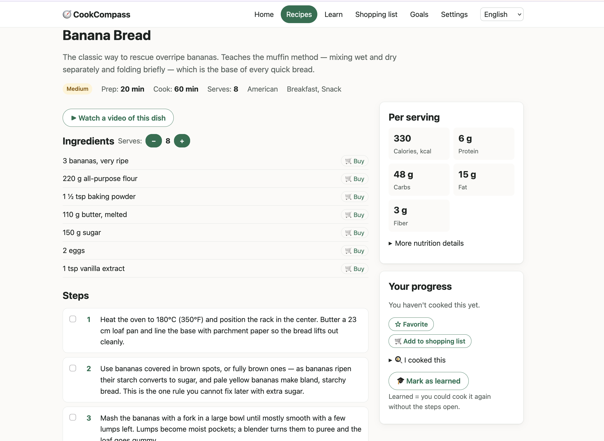
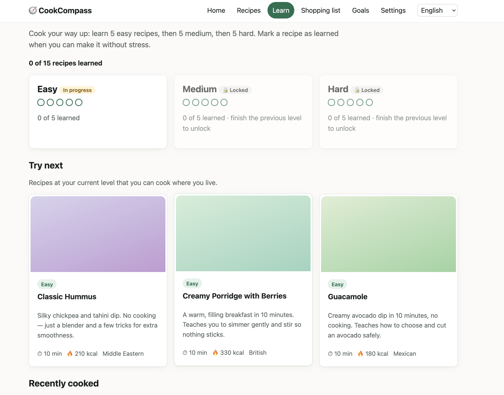
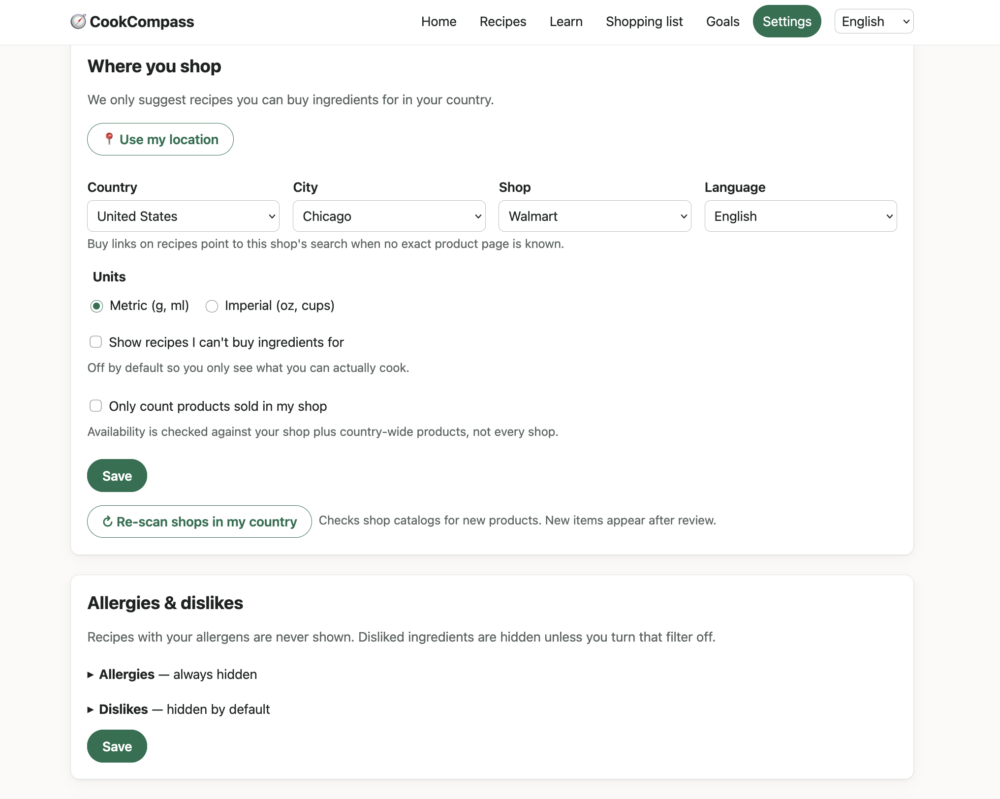

# CookCompass

A self-hosted web app that teaches you to cook, and only suggests recipes whose ingredients are sold where you live.
It ships ready to use: 46 bilingual (EN/RU) beginner-friendly recipes from 14 cuisines, a grocery catalog and shop list
for 4 countries, a UI in English, Russian, German, Spanish and French, a daily meal plan for your nutrition goal,
a learning path from easy to hard, and a shopping list with "buy" links into your own shop. No cloud, no tracking.

| Recipe: scaler, buy links, nutrition | Learning path: easy → medium → hard | Settings: country, city, shop |
|---|---|---|
| [](docs/screenshots/recipe.png) | [](docs/screenshots/learn.png) | [](docs/screenshots/settings.png) |

## Install (2 minutes)

You need Docker with Compose v2 and `make`. Go 1.24 is only needed to build from source.

```sh
git clone https://github.com/abdulovia/cookcompass.git && cd cookcompass
make init          # creates .env with fresh admin/storage passwords, prints them
make up-release    # runs the prebuilt image   (or: make up — builds from source)
```

Open http://localhost:8080. The admin area is at http://localhost:8080/admin; the user and password were printed by `make init`
and live in `.env`. Its **Getting started** card (same as `make doctor`) lists what is ready and what is left to do.

## What's left for you

1. **Settings**: your country, city and shop, language and units; tick allergies and what's in your pantry.
2. **Add a couple of your own recipes.** Pick any of these, all explained in [docs/recipes.md](docs/recipes.md):
   *Admin → Recipes → New*; drop a JSON file into `content/recipes/`; or *Admin → Queue → Scrape now: themealdb*,
   which imports ~800 recipes with photos and videos into the review queue.
3. Optional: rename the site, change its colour, switch features off, add a country or your shop, or rewrite any text.
   All of it happens in `content/`, without a rebuild ([docs/content.md](docs/content.md)).

## Everyday commands

| Command | What it does |
|---|---|
| `make up` / `make up-release` / `make down` | start (build from source / prebuilt image) or stop the stack |
| `make doctor` | check the installation and print what is left to do |
| `make backup` | snapshot the database into `backups/` |
| `make scrape-recipes SOURCE=themealdb` | import recipes into the review queue (`jsonld`, `dataset` also available) |
| `make import-recipes FILE=x.json` | import a recipe dataset from `data/recipe-inbox/` |
| `make approve-all` / `make purge-pending` | accept or drop everything waiting for review |
| `make test` / `make ci` | tests with coverage gate / every CI gate locally |

CLI targets use the local binary; add `RUN="docker compose exec -T app /app/cookcompass"` to run them inside the container.
Optional extras: `docker compose --profile tls up -d` (local HTTPS via Caddy), `--profile translate` (self-hosted
LibreTranslate that drafts recipe translations for review).

## Documentation

- [docs/install.md](docs/install.md): install, upgrade, backups, running without Docker, troubleshooting
- [docs/recipes.md](docs/recipes.md): adding recipes, and where to get more (with licensing notes)
- [docs/content.md](docs/content.md): branding, features, countries, shops, products and texts via `content/`
- [docs/architecture.md](docs/architecture.md): how the pieces fit together
- [docs/ingestion.md](docs/ingestion.md) · [docs/pipelines.md](docs/pipelines.md) · [scripts/add-locale.md](scripts/add-locale.md)
- [DECISIONS.md](DECISIONS.md) (every open choice, one line each) · [CHANGELOG.md](CHANGELOG.md)
- License: [MIT](LICENSE); imported recipes keep their source's terms ([docs/recipes.md](docs/recipes.md))
